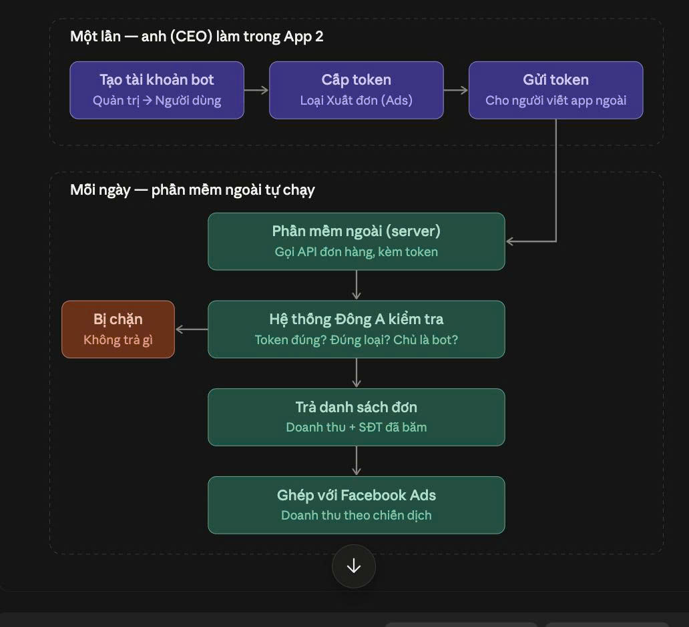
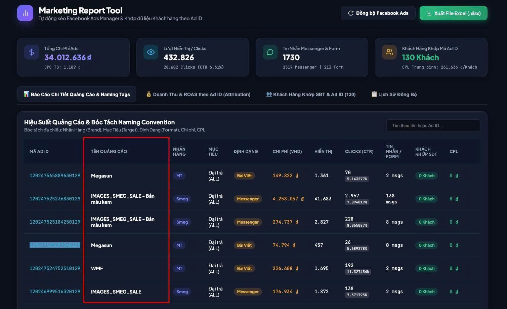
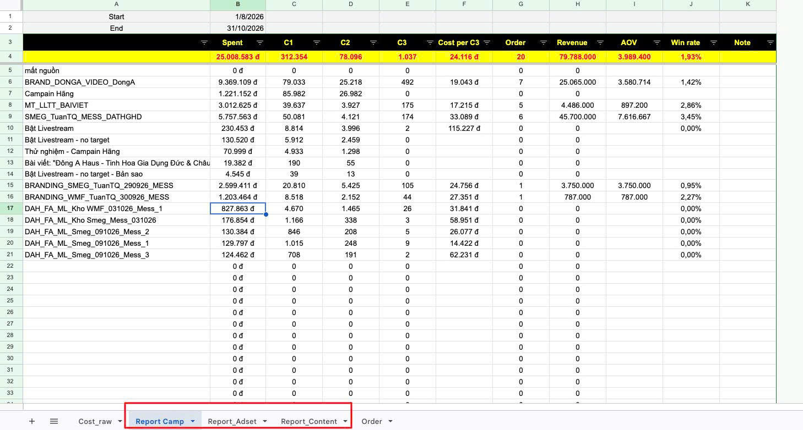
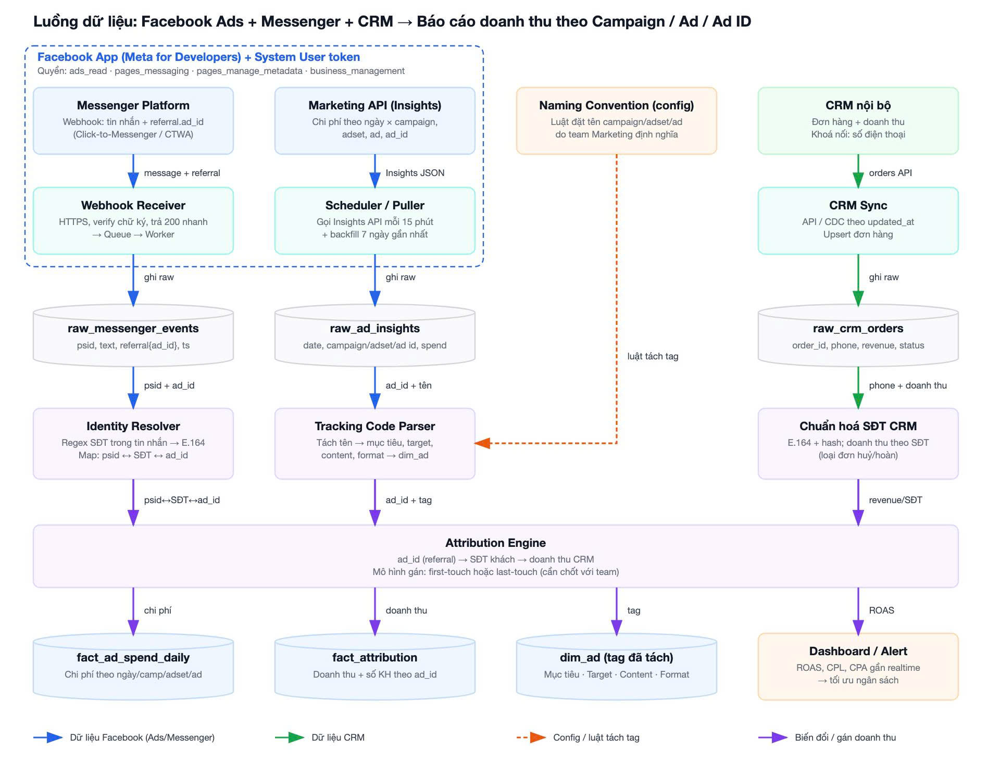
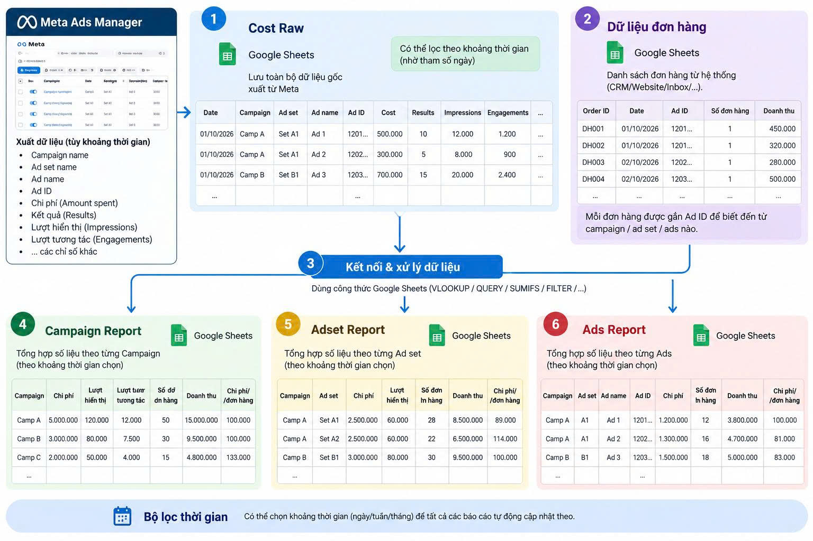
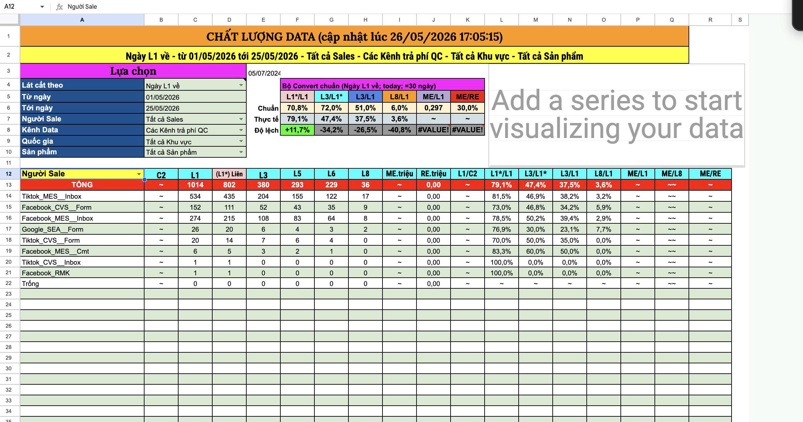

Tên đăng nhập/ mật khẩu nha:
hunghv
Hunghv@123
Link: https://donga-hethong-production.up.railway.app/
Token của hùng nha: dak_sv0mjACmnhlRFlz7zpwOtYiOBc9fxytenk63Zttow80

[11/10/2026 23:37:41] Trần Quốc Tuấn: @Nguyễn Mạnh Linh  ơi, em order sửa gì
[11/10/2026 23:37:45] Trần Quốc Tuấn: thì báo anh @Hoàng Việt Hùng  nha
[11/10/2026 23:40:06] Nguyễn Mạnh Linh: [Hình ảnh] 

[11/10/2026 23:40:17] Nguyễn Mạnh Linh: Đang nói bảng này anh nhở
[11/10/2026 23:40:26] Nguyễn Mạnh Linh: https://marketing-ads-one.vercel.app/
[11/10/2026 23:40:50] Trần Quốc Tuấn: Muốn hiển thị như nào thì em chụp cái mẫu
[11/10/2026 23:40:53] Trần Quốc Tuấn: gửi anh ý
[11/10/2026 23:42:28] Trần Quốc Tuấn: Nếu sau bóc theo chiều content
[11/10/2026 23:42:32] Trần Quốc Tuấn: mã content
[11/10/2026 23:42:38] Trần Quốc Tuấn: Thì ngon
[11/10/2026 23:43:05] Nguyễn Mạnh Linh: Đúng rồi
Em đặt getname có công thức sẵn rồi đấy
Giờ ốp đc vào luôn
[11/10/2026 23:43:14] Nguyễn Mạnh Linh: [Hình ảnh] 
[11/10/2026 23:43:19] Nguyễn Mạnh Linh: bảng thủ công thì đang thế này
[11/10/2026 23:43:23] Nguyễn Mạnh Linh: https://docs.google.com/spreadsheets/d/1e2A8EGIK7Fsc9mD1_BRc0fbI9XWcd_tFLbVGQTBGg5w/edit?gid=396984656#gid=396984656
[11/10/2026 23:43:47] Trần Quốc Tuấn: Dữ liệu doanh thu em lấy đâu ra vậy ;v
[11/10/2026 23:43:52] Trần Quốc Tuấn: Điền tay à :v
[11/10/2026 23:43:59] Nguyễn Mạnh Linh: Ngoài track theo chiều mã ad id
Thì em cần track theo: camp, adset, content nữa
[11/10/2026 23:44:22] Nguyễn Mạnh Linh: @Tuấn Quốc Trần Đúng rồi, em báo Quảng điền mấy đơn gần đây đấy
[11/10/2026 23:44:35] Nguyễn Mạnh Linh: Nhưng đang k đủ
[11/10/2026 23:44:38] Trần Quốc Tuấn: Em muốn nhìn theo chiều nào, thì em vẽ mô tả ảnh hoặc luồng ra
[11/10/2026 23:44:46] Trần Quốc Tuấn: anh @Hoàng Việt Hùng  sẽ hỗ trợ nha 
[11/10/2026 23:44:54] Trần Quốc Tuấn: [Hình ảnh] 
[11/10/2026 23:45:00] Trần Quốc Tuấn: Báo chat gpt nó vẽ cho :v
[11/10/2026 23:45:01] Nguyễn Mạnh Linh: Thế chắc ngồi 1 buổi 1-1 anh ạ
[11/10/2026 23:45:07] Nguyễn Mạnh Linh: Cho ló dễ =)))
[11/10/2026 23:45:17] Trần Quốc Tuấn: Anh Hùng hiểu nhanh :)
[11/10/2026 23:45:19] Trần Quốc Tuấn: chỉ cần logic thôi
[11/10/2026 23:46:48] Nguyễn Mạnh Linh: Nhanh thui a ơi, luồng đơn giản mà
Tối mai anh có rảnh k? 15-20p thoay @Hoàng Việt Hùng
[11/10/2026 23:48:18] Trần Quốc Tuấn: Ae ngồi quy chuẩn bộ tracking code luôn
[11/10/2026 23:48:35] Trần Quốc Tuấn: Sau cho AI nó bóc theo nhãn để phân loại content và định dạng content ý :v
[12/10/2026 21:34:39] Nguyễn Mạnh Linh: [Hình ảnh] 
[12/10/2026 21:34:54] Nguyễn Mạnh Linh: @Hoàng Việt Hùng em gửi nhé
[12/10/2026 21:35:07] Nguyễn Mạnh Linh: https://docs.google.com/spreadsheets/d/1e2A8EGIK7Fsc9mD1_BRc0fbI9XWcd_tFLbVGQTBGg5w/edit?gid=1078436265#gid=1078436265
[12/10/2026 21:35:12] Nguyễn Mạnh Linh: Hiện tại đang chạy thủ công qua file này
[12/10/2026 22:52:30] Trần Quốc Tuấn: Hùng cứ làm đi quan trọng là nhìn được doanh thu theo chiều campain chiến dịch nhóm hoặc quảng cáo
[12/10/2026 22:52:59] Trần Quốc Tuấn: cái ver 2 thì sẽ bóc theo tên của từng cái đó nhưng bóc nhỏ các chiều
[12/10/2026 22:53:10] Trần Quốc Tuấn: Ví dụ như mess_TuanTQ_Chiến dịch ads
[12/10/2026 22:53:26] Trần Quốc Tuấn: Thì bóc nhỏ tầng mes với tuantq trong tên ý
[12/10/2026 23:00:00] Trần Quốc Tuấn: Với tuấn có 1 app
[12/10/2026 23:00:23] Trần Quốc Tuấn: Nó có lưu theo đơn hàng gồm số điện thoại và tên và doanh thu
[12/10/2026 23:00:34] Trần Quốc Tuấn: Tuấn tạo api cho hùng xuất dữ liệu nha
[12/10/2026 23:11:20] Trần Quốc Tuấn: https://developers.facebook.com/documentation/ads-commerce/conversions-api/parameters
[12/10/2026 23:11:27] Trần Quốc Tuấn: Doc của fb đây hùng nha

